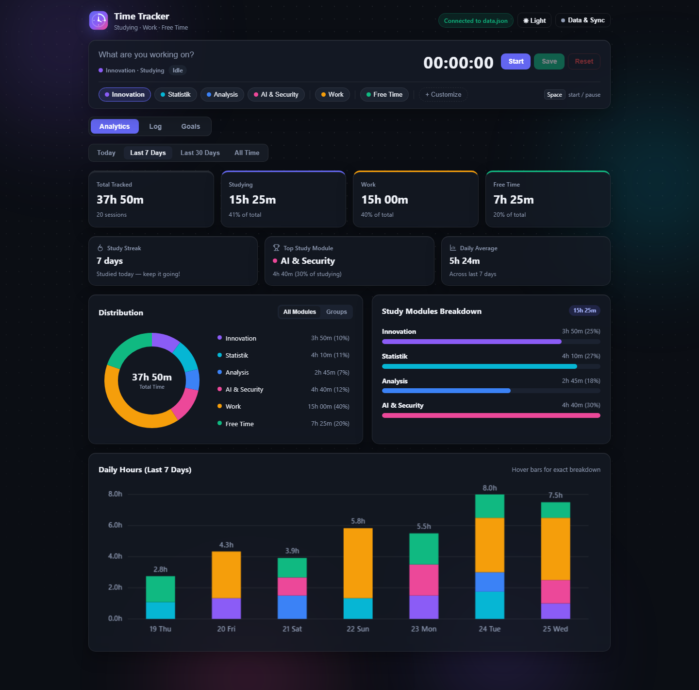
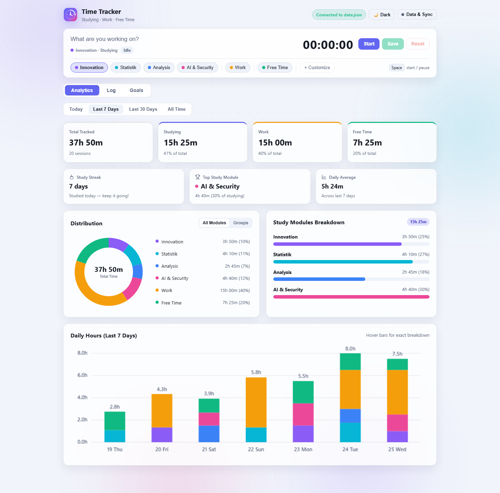
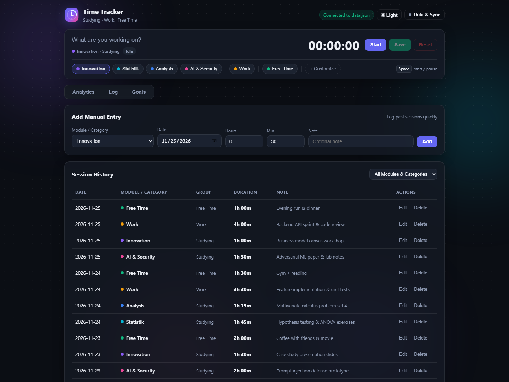

# Time Tracker

A calm, zero-dependency, offline-first time tracker for **Studying**, **Work**, and **Free Time** — inspired by Toggl Track, solidtime, and Pomotroid.

Track your own custom study modules, work projects, or free-time activities with a pinned live timer bar, clean interactive analytics charts, weekly goals, and automatic local + Google Drive backup.

## Demo Preview

### Analytics Dashboard (Dark Mode)


### Analytics Dashboard (Light Mode)


### Session Log & Manual Entry


## Features

- **Pinned Live Timer Bar** — Always-accessible *"What are you working on?"* input, live `HH:MM:SS` readout, live browser tab title, and **Spacebar** start/pause shortcut.
- **Fully Customizable Modules & Categories** — Organize anything you want under **Studying**, **Work**, and **Free Time**. Add, rename, recolor (10 accent colors), delete, or switch between 3 one-click starter presets (*University Student*, *Developer / Work*, *Minimal*).
- **Calm 3-Tab Layout**:
  - **Analytics**: KPI cards, quick insights (Study Streak, Top Study Module, Daily Average), interactive Distribution Donut chart, Study Modules breakdown, and 7-Day Stacked Bar chart with hover tooltips.
  - **Log**: Compact manual time entry + searchable/filterable Session History with Edit and Delete.
  - **Goals**: Editable weekly hour targets for Studying, Work, and Free Time with progress bars.
- **Zero Dependencies & Offline-First** — Pure HTML, CSS, Vanilla JS, and Python standard library. No build step, no `npm install`, no tracking.
- **Automatic Local & Google Drive Backup** — Saves automatically to `localStorage`, local `data.json`, and mirrors to **Google Drive for Desktop** (`<Drive>:\My Drive\Time Tracking\data.json`) when mounted. Also supports JSON/CSV export & import and optional direct in-browser Google Drive OAuth sync.
- **Dark & Light Themes** — Smoothly themed across every chart, modal, and tooltip.

## 30-Second Quick Start

### Option A: Recommended (Auto-saves to `data.json` + Google Drive for Desktop)
1. Clone or download this repository.
2. On Windows, double-click **`Start Time Tracker.bat`** — or run from any terminal:
   ```bash
   python server.py
   ```
3. Open **http://localhost:8765** in your browser.

### Option B: Instant Offline Mode (No Python Required)
Double-click **`index.html`** to open it directly in any browser. All sessions, custom modules, and goals are saved automatically in `localStorage`.

## Customizing Your Modules

Click **`+ Customize`** next to the category pills (or **Customize Modules** in the welcome banner) to:
- Add new modules under **Studying**, **Work**, or **Free Time** with your choice of accent color.
- Rename or remove existing modules (historical sessions keep their last saved name/color so your analytics stay intact).
- Apply a starter preset: **University Student**, **Developer / Work**, or **Minimal (Study / Work / Free)**.

## Automatic Local & Google Drive Backup

When running via `server.py`:
- Every change is atomically written to `data.json` in the project folder.
- If **Google Drive for Desktop** is mounted (`D:`–`Z:\My Drive` or `%USERPROFILE%\Google Drive`), `server.py` automatically creates `My Drive\Time Tracking\data.json` and keeps both files merged and in sync.
- Want a custom sync folder (Dropbox, iCloud, OneDrive, etc.)? Create a `config.json` next to `server.py`:
  ```json
  {
    "drive_data_path": "C:/Users/you/MySyncFolder/Time Tracking/data.json"
  }
  ```

## Keyboard Shortcuts

- **`Space`** — Start or pause the live timer (when not typing in a text field)
- **`Escape`** — Close any open modal

## License

MIT License — see [LICENSE](LICENSE).
